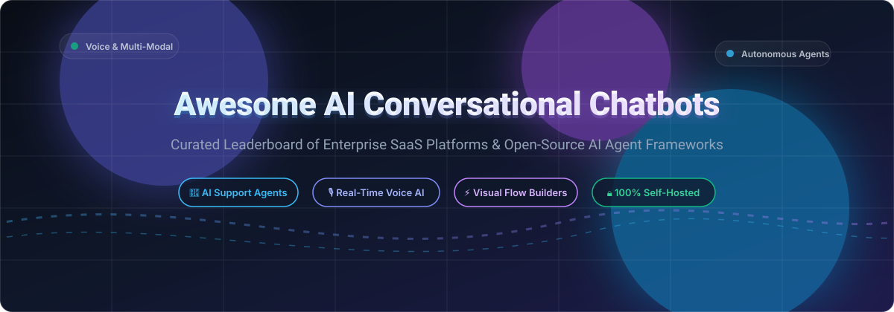

  

# 🤖 Awesome AI Conversational Chatbot

  
  
  
  
  
  
  

> 🌟 **The definitive curated list of AI Conversational Chatbots, Autonomous Customer Support Agents, Real-Time Voice Frameworks, Visual Flow Builders, and Self-Hosted LLM Platforms.** 🌟
>
> Updated monthly with transparent pricing, free-tier limits, company valuation data, and open-source star metrics.

---

## 📌 Table of Contents

- [📊 Sector Overview & Market Dynamics](#-sector-overview--market-dynamics)
- [🏢 Enterprise SaaS & Hosted Platforms](#-enterprise-saas--hosted-platforms)
- [💻 Open-Source GitHub Projects & Frameworks](#-open-source-github-projects--frameworks)
- [📈 Star History](#-star-history)
- [🤝 How to Contribute](#-how-to-contribute)
- [💖 Support & Sponsorship](#-support--sponsorship)
- [⚖️ Disclaimer & Guidance](#️-disclaimer--guidance)

---

## 📊 Sector Overview & Market Dynamics

The global **conversational AI and autonomous chatbot market** is valued at approximately **$15B–$20B in 2026** and projected to surge past **$75B–$100B by the mid-2030s (at a ~20%–24% CAGR)**.

- **Market Structure**: The sector exhibits a **moderately fragmented ecosystem** rather than a winner-take-all monopoly.
- **Selective Consolidation vs. Domain Specialization**: Foundational hyperscalers (Google, Microsoft, AWS) and large enterprise platforms (Zendesk, Freshworks) command infrastructure and broad enterprise helpdesks. Simultaneously, hundreds of fast-moving companies thrive in specialized niches: real-time low-latency voice, complex visual state machines, multichannel messaging (WhatsApp/SMS), and self-hosted privacy-first deployments.

---

## 🏢 Enterprise SaaS & Hosted Platforms

A transparent comparison of industry-leading commercial AI conversational chatbot platforms, ordered by company valuation / ARR (descending):

| Company / Product | Company Size (Valuation / Revenue) | Starting Pricing (Specific Tiers) | Free Tier & Trial Limits | Description & Trade-offs |
|---|---|---|---|---|
| **Zendesk AI** | **$10.2B valuation** (~$2B ARR) | **$55/agent/month** (billed annually for Suite Team; includes 5 automated resolutions/agent/month; legacy Support Team from $19/agent/month without omnichannel/chat) | **14-day free trial** with full access to Zendesk Suite Professional features (no credit card required; eligible for one 14-day extension). No permanent free plan. | Enterprise omnichannel customer support suite integrating AI agents, live chat, and ticketing. *Trade-off: Resolution allocations capped per plan; overages billed separately.* |
| **Freshworks Freddy AI** | **$4.5B market cap** (~$800M+ ARR) | **$19/agent/month** (billed annually for Freshchat Growth; Freddy AI Agent add-on at $49 per 100 sessions; Freddy Copilot at $29/agent/month) | **Permanent free plan** up to 10 human agents ($0/month, web chat only; AI sessions require paid add-on packs). Also offers a **14-day free trial** of Enterprise tier. | Omnichannel conversational AI and support agent inside Freshchat suite. *Trade-off: Freddy AI sessions are metered separately from agent seats.* |
| **Intercom Fin** | **$1.28B valuation** (~$350M+ ARR) | **$29/seat/month** (billed annually for Essential plan, promotional from $19/seat/month) + **$0.99 per resolution/outcome** for Fin AI Agent | **14-day free trial** with complete access to chosen plan features including Fin AI Agent (no credit card required; optional 7-day extension for qualifying accounts). No permanent free tier. | AI-first customer service platform designed around autonomous resolution agents. *Trade-off: Seat subscriptions stack on top of outcome-based resolution charges.* |
| **Ada** | **$1.2B valuation** (~$70M+ ARR) | **$33,000/year** (AWS Marketplace entry for up to 60,000 conversations; standard enterprise contracts start at $60,000/year) | **No free plan, no free trial**; access is strictly demo-driven with custom enterprise scoping and Proof of Value (POV). | Action-taking agentic customer experience platform with deep multi-system enterprise integrations. *Trade-off: High entry price point; onboarding and implementation adds $15,000–$100,000+.* |
| **Drift** | **$1.0B valuation** (~$120M ARR) | **$2,500/month** (billed annually as $30,000/year minimum commitment for Premium tier; Advanced & Enterprise tiers custom quoted) | **No free plan, no free trial**; platform access requires sales consultation and demo. | Conversational marketing and B2B sales engagement chatbot platform. *Trade-off: High annual minimum spend; contracts require sales consultation.* |
| **Kustomer AI** | **$1.0B valuation** (~$35M+ ARR) | **$89/user/month** (billed annually for Enterprise plan; minimum 8 seats / $8,544/year baseline; Ultimate plan at $139/user/month; AI agents & voice billed as add-ons) | **No free plan, no self-serve free trial**; evaluation requires a scheduled live demo and custom sales-approved pilot. | Unified omnichannel CRM and customer service platform with conversational AI orchestration. *Trade-off: Strict 8-seat minimum commitment and no self-serve setup.* |
| **LivePerson** | **$300M+ valuation** (~$244M annual revenue) | **Custom quote starting at ~$5,000/month** (procurement data indicates median entry contracts around $60,945/year; SMS/WhatsApp carrier fees + 15% handling fee) | **No free plan, no self-serve free trial**; evaluation requires a guided sales demo and managed Proof of Concept (PoC). | Enterprise conversational AI and messaging engine across digital channels and SMS. *Trade-off: Substantial enterprise commitment; messaging carrier fees incur a 15% handling surcharge.* |
| **Tidio Lyro** | **~$150M valuation** (~$40M ARR) | **$24.17/month** (billed annually for Starter plan; Lyro AI Agent plans start at $32.50/month for 50 AI conversations; billed separately) | **Permanent free plan** for up to 10 agents, 50 human conversations/month, 100 flow visitors, and a one-time lifetime quota of 50 Lyro AI conversations. Also offers a **7-day free trial** of paid tiers. | Accessible live chat and customer service automation with the Lyro AI agent for SMBs. *Trade-off: Help desk capabilities and Lyro AI conversation quotas are packaged separately.* |
| **Forethought** | **~$90M venture-backed** (~$60M annual revenue) | **Custom quote starting at ~$2,900/month** (procurement data indicates entry annual contracts between $35,000 and $150,000/year based on ticket volume) | **No self-serve free trial and no free plan**; offers an enterprise Proof of Value (POV) sandbox on historical ticket data during sales cycles. | Generative AI customer support automation with Solve (autonomous resolution), Assist (copilot), and Triage. *Trade-off: Requires sales-led POV and volume contract negotiation.* |
| **Landbot** | **~$25M valuation** (~$5.2M ARR) | **$36/month** (billed annually for Starter plan with 500 chats and 100 AI chats; Professional at $88/month with 2,500 chats and 300 AI chats) | **Permanent free plan (Sandbox)** with 100 chats/month and 1 user seat (web channels only, no AI). Also offers an unrestricted **14-day free trial** of premium features. | Visual no-code chatbot builder for interactive web experiences and WhatsApp automations. *Trade-off: AI-powered chats are strictly metered; WhatsApp API adds third-party messaging costs.* |

---

## 💻 Open-Source GitHub Projects & Frameworks

Ranked by **GitHub Stars_Counts** (descending) with live badges linking to each repository's stargazers page:

### 1. [Ollama](https://github.com/ollama/ollama)  🦙
- **Category**: Local LLM Runner & Inference Server
- **Tech Stack**: Go, C/C++
- **Overview**: Get up and running with Llama 3, Mistral, Gemma, and custom models locally. Serves as the premier privacy-first inference engine backing self-hosted conversational AI pipelines.
- **Best For**: Developers seeking zero-data-leakage local execution for offline or private chatbot deployments.

### 2. [Dify](https://github.com/langgenius/dify)  🚀
- **Category**: LLM Application & Conversational Agent Platform
- **Tech Stack**: Python, TypeScript, Next.js
- **Overview**: An open-source LLM app development platform combining AI workflow orchestration, Agent capabilities, RAG pipelines, and conversational interfaces with out-of-the-box observability.
- **Best For**: Teams needing a full-stack, enterprise-grade chatbot builder with visual prompt engineering, RAG, and multi-model routing.

### 3. [Langflow](https://github.com/langflow-ai/langflow)  🌊
- **Category**: Visual Flow Builder for Multi-Agent & Chatbot Systems
- **Tech Stack**: Python, React
- **Overview**: A dynamic visual framework where you can drag-and-drop components to assemble LangChain-based conversational workflows, memory stores, and API tools effortlessly.
- **Best For**: Rapid prototyping and visual construction of complex, multi-step LLM conversational pipelines.

### 4. [Flowise](https://github.com/FlowiseAI/Flowise)  🔌
- **Category**: Low-Code UI for LLM Apps & Conversational Agents
- **Tech Stack**: TypeScript, Node.js, React
- **Overview**: Drag-and-drop UI tool designed to build customized LLM flows, conversational agents, and interactive chat widgets deployable via embeds and REST APIs.
- **Best For**: Embedding custom AI chatbots into websites without writing boilerplate backend code.

### 5. [Chatwoot](https://github.com/chatwoot/chatwoot)  💬
- **Category**: Open-Source Customer Engagement Suite & Omnichannel Helpdesk
- **Tech Stack**: Ruby on Rails, Vue.js
- **Overview**: Open-source alternative to Intercom, Zendesk, and Drift. Connects WhatsApp, Twitter, Email, and Web Chat into a unified inbox with native bot integrations and AI assistance.
- **Best For**: Support teams seeking self-hosted customer messaging with seamless human handoff from automated chatbots.

### 6. [Langchain-Chatchat](https://github.com/chatchat-space/Langchain-Chatchat)  📚
- **Category**: Local Knowledge Base & RAG Conversational Assistant
- **Tech Stack**: Python, LangChain, Milvus/FAISS
- **Overview**: Enterprise-oriented offline RAG chatbot solution supporting document ingestion (PDF, Word, Markdown) and multi-model local inferences.
- **Best For**: Internal enterprise document question-answering with complete data residency.

### 7. [Haystack](https://github.com/deepset-ai/haystack)  🌾
- **Category**: End-to-End LLM Orchestration & Search Pipeline Framework
- **Tech Stack**: Python
- **Overview**: Production-ready Python framework for building custom RAG, neural search, and conversational AI agents with flexible modular components.
- **Best For**: Engineering teams building high-throughput production search and conversational retrieval architectures.

### 8. [Rasa](https://github.com/RasaHQ/rasa)  🧠
- **Category**: Conversational AI Engine for Enterprise Dialogue Management
- **Tech Stack**: Python, TensorFlow/PyTorch
- **Overview**: Industry-standard open-source conversational AI framework with CALM (Conversational AI with Language Models), intent classification, dialogue policies, and compliance readiness.
- **Best For**: Large-scale enterprise systems requiring deterministic guardrails, structured conversational flows, and hybrid NLU/LLM setups.

### 9. [Pipecat](https://github.com/pipecat-ai/pipecat)  🎙️
- **Category**: Real-Time Voice & Multimodal Conversational Agent Framework
- **Tech Stack**: Python, WebRTC
- **Overview**: The most complete open-source framework for building ultra-low-latency real-time voice and multimodal AI agents. Pluggable with 20+ STT engines, 25+ LLMs, and 30+ TTS voices.
- **Best For**: Real-time voice assistants, phone agents, and multimodal conversational interfaces requiring WebRTC speed.

### 10. [Botpress](https://github.com/botpress/botpress)  🛠️
- **Category**: Developer Chatbot Engine & Visual Flow Studio
- **Tech Stack**: TypeScript, Node.js
- **Overview**: Developer-centric conversational platform featuring visual dialogue flows, NLU pipelines, and pre-built channel connectors for enterprise bots.
- **Best For**: Developers needing granular control over dialogue states, custom actions, and channel integrations.

### 11. [Apache Burr](https://github.com/dagworks-inc/burr)  ⚙️
- **Category**: State-Machine Framework for Stateful LLM Applications
- **Tech Stack**: Python
- **Overview**: Expresses chatbot interactions and multi-step agent decisions as rigorous state machines, complete with built-in real-time tracing, telemetry UI, and state persistence.
- **Best For**: Complex conversational systems requiring full auditability, rollback, and deterministic multi-turn state tracking.

### 12. [Owly](https://github.com/Hesper-Labs/owly)  🦉
- **Category**: Self-Hosted Multichannel AI Customer Support Agent
- **Tech Stack**: Next.js 14, TypeScript, PostgreSQL, Prisma, Docker
- **Overview**: Autonomous customer service agent supporting WhatsApp (QR login), Email (IMAP/SMTP), and Phone (Twilio + Whisper + ElevenLabs) with a unified admin inbox and ticketing dashboard.
- **Best For**: SMBs and privacy-conscious organizations seeking a self-hosted support agent without per-resolution SaaS markups.

---

## 📈 Star History

---

## 🤝 How to Contribute

Contributions are warmly welcome! Help make this the most accurate and transparent conversational AI directory:

1. 🍴 **Fork** this repository.
2. 📝 **Add or update** entries in `README.md` (keep descriptions factual, include starting pricing, free tier terms, or open-source star metrics).
3. 🔍 **Verify** links and ensure proper markdown table alignment.
4. 🚀 **Submit a Pull Request** with a concise summary of changes.

---

## 💖 Support & Sponsorship

If this curated guide saved your team research time, helped you evaluate chatbot architectures, or sparked new ideas, please consider supporting the project:

- ⭐ **Star this repository** to boost discovery and help fellow builders!
- 🍴 **Fork & Share** with your engineering and product networks.
- ☕ **Buy me a coffee / Sponsor**: Support ongoing maintenance via the [GitHub Sponsors Dashboard](https://github.com/sponsors/ishandutta2007).

---

## ⚖️ Disclaimer & Guidance

- **Community Curated**: This list is independently curated for research and evaluation purposes; it does not constitute commercial endorsement.
- **Data Compliance & Security**: Chatbot solutions process customer conversations and potential PII. Ensure self-hosted setups and third-party SaaS vendors comply with applicable data protection legislation (GDPR, CCPA, HIPAA, SOC 2).
- **Architecture Matching**:
  - Need real-time voice? Consider **Pipecat**.
  - Need visual workflow orchestration? Look at **Dify**, **Langflow**, or **Flowise**.
  - Need a turnkey multichannel support agent? Evaluate **Owly** or **Chatwoot**.
  - Need verifiable state management? Choose **Apache Burr**.

---

  <b>Built for conversational AI developers, product engineers, and customer experience innovators worldwide.</b>

